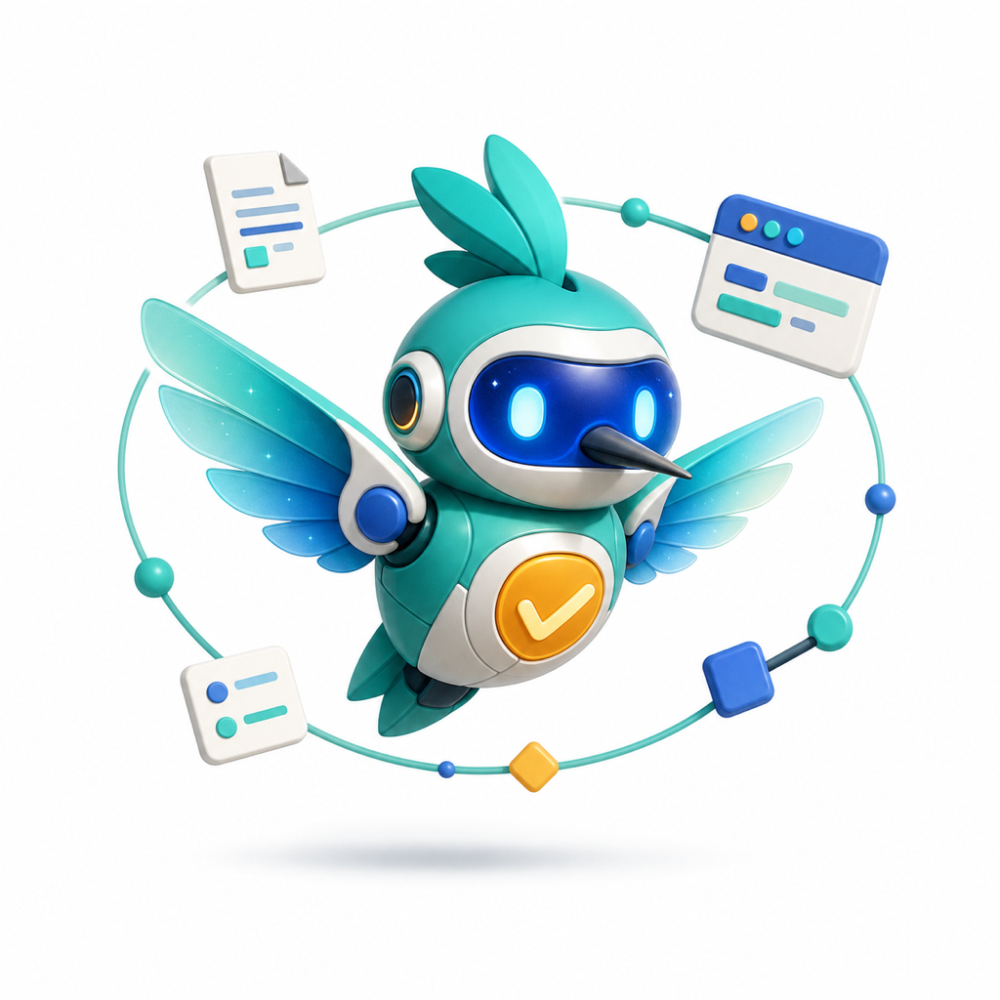

<div align="center">
  

  <h1>Venti</h1>

  <p><strong>Your browser agent says "it passed."<br/>Venti demands the receipts.</strong></p>
  <p>브라우저 에이전트는 "통과했어요"라고 말한다.<br/>벤티는 영수증을 내놓으라고 한다.</p>

  <p>
    
    
    
    
  </p>
</div>

---

**Venti** is an evidence-first QA harness for browser agents and web applications.

URL 하나와 목표 한 줄이면 — 안전하게 **정찰**하고, 테스트 계약을 **동결**하고, 진짜 브라우저와
API로 **실행**하고, 모든 기대를 **검증**하고, 전 과정을 재생 가능한 **증거**로 남긴다.

Claude Code·Codex 위에서 에이전트로 굴러가지만, **실행 코어는 LLM 의존성 0인 독립 Node CLI**다.
No model? Plans still run. With a model? Scouting, planning, recovery, and auditing come alive.

## The Three Lies

LLM 에이전트에게 QA를 시키면 세 종류의 거짓말이 돌아온다. 벤티는 각각에 구조로 대답한다.

| The lie | The structure |
| --- | --- |
| 안 눌러놓고 "눌렀습니다" | 모든 `pass`에 스크린샷·페이지 텍스트·액션 원장 등 **증거 아티팩트 강제**. 증거 없으면 `needs_human` — 절대 pass 아님 |
| 셀렉터 바꿔치기 해놓고 "통과했습니다" | Self-heal은 **1회 한정 + `pass_needs_review` 강등**. Auditor가 원본 증거로 재검증하기 전까지 승격 금지 |
| 대충 훑고 "전반적으로 좋아 보여요" | **Deterministic checks first.** LLM 판정은 플랜에 선언된 rubric(기준·앵커·`unknown` 탈출구 포함)에서만 허용 |

> **Deterministic where possible. Agentic where necessary. Replayable always.**

## Receipts, or it didn't happen

모든 run은 이런 증거 트리를 남긴다. 모든 `pass`는 이 트리를 가리켜야 하고, 못 가리키면
pass가 아니다.

```text
runs/20260804_1032_search-smoke/
├── manifest.json         # plan hash, target boundary, budgets, execution mode
├── results.jsonl         # 아이템별 판정 + 기대별 체크 레코드 전부
├── events.jsonl          # append-only 그래프 전이 로그 (중단 시 재개 지점)
├── report.md             # Result: 5 items — 3 pass, 1 fail, 1 needs human
└── evidence/search-basic/attempt-1/
    ├── screenshot.png    # 실제로 본 화면
    ├── page.txt          # 실제로 읽은 텍스트
    ├── url.txt           # 실제로 있던 주소
    └── actions.jsonl     # 실제로 한 행동, 타임스탬프까지
```

## Quick start

Node.js 20+ 필요. 30초면 된다.

```bash
npm ci
npm run check                # lint + contract tests + plan validation

# 공개 안전 타깃(example.com) 스모크
./bin/venti-run run plans/example-web-smoke.yaml --provider agent-browser

# 브라우저 없이 플랜만 검증
./bin/venti-run run plans/example-web-smoke.yaml --dry-run --json
```

## Claude Code

```text
/mini-venti https://your-site.example
```

Scout → 테스트 선택지 제안 → 승인 → plan freeze → execute → verify → audit → report →
지식 축적까지 풀 플로우가 돈다. 단, 텐션은 대화까지고 — **판정과 리포트는 페르소나 없이
팩트만 남긴다. `fail`은 `fail`이다.**

Codex 등 다른 에이전트 런타임이라면:

```text
Read AGENTS.md, .claude/skills/mini-venti/SKILL.md, and docs/contracts/.
Run a full Venti QA flow for https://your-site.example.
```

오케스트레이션 계약은 [.claude/skills/mini-venti/SKILL.md](.claude/skills/mini-venti/SKILL.md),
이식 가능한 역할 프롬프트는 [agents/](agents/), Claude 전용 래퍼는
[.claude/agents/](.claude/agents/)에 있다.

## Execution graph

```text
intake → context → auth → scout → plan → approval → freeze
  → setup → act → observe → verify
  → classify → bounded retry / one-shot heal / human review
  → audit → regression compare → report → learn
```

바깥 그래프는 결정론적 워크플로, 안쪽 루프는 전부 예산이 걸린(bounded) 에이전트 포켓이다.
Retry는 최대 N회, heal은 딱 1회, heal은 무조건 audit행. 토폴로지·웨이브 스케줄링·안전
기본값은 기계가독 형식으로 [config/graph.yaml](config/graph.yaml) ·
[config/policy.yaml](config/policy.yaml)에 있고, 계약은
[schemas/plan.schema.json](schemas/plan.schema.json) ·
[schemas/result.schema.json](schemas/result.schema.json)이 정의한다.

## Providers

플랜은 그대로 두고 브라우저 런타임만 갈아끼운다.

| Provider | Use it for | Runtime |
| --- | --- | --- |
| `agent-browser` | CLI 세션, 시맨틱 로케이터, 인증/세션 워크플로 | `agent-browser` |
| `playwright` | 결정론적 브라우저 단언, 트레이스, 직접 실행/CDP | optional `playwright` |
| `browser-use` | 현행 Browser Use 하네스 (CDP) | `browser-use` / `uvx` |
| `browser-use-cli` | 레거시 Browser Use CLI 호환 | installed CLI |
| `jsonl` | Python/TypeScript/Rust/원격 커스텀 어댑터 | JSONL sidecar |
| `stagehand` · `browsergym` · `mcp` | 벤더/런타임 특화 브리지 | JSONL sidecar |
| `http` | 안전한 GET/HEAD API 체크 | Node `fetch` |
| `mock` | 결정론적 계약 테스트·CI | built-in |

다른 런타임을 코어 결합 없이 붙이는 법:
[docs/contracts/bridge-protocol.md](docs/contracts/bridge-protocol.md)

## Repository map

```text
.claude/skills/mini-venti/  Claude Code orchestrator (운영 절차서)
.claude/agents/             Claude Code 역할 래퍼 (핵심 규칙 내장)
agents/                     portable scout/planner/runner/verifier 등 역할 계약
src/runner.js               schema-validated deterministic executor
src/providers/              provider adapters + JSONL bridge
bin/venti-run               standalone Node CLI
plans/                      YAML plans
schemas/                    plan/result JSON Schema
config/                     graph topology + safety policy + wave scheduling
docs/contracts/             run / adapter / bridge / subagent contracts
sites/<target-key>/         audited target knowledge (공개·무해화만)
runs/<run-id>/              local evidence output (gitignored)
```

비공개·환경 특화 타깃 지식은 gitignore된 `.local-targets/`에만 둔다.

## Design principles — non-negotiable

1. **Evidence before claims.** 관찰 가능한 기대 + 첨부된 증거가 없는 pass는 존재하지 않는다.
2. **Plan before mutation.** 사용자가 고르지 않은 기능은 테스트하지 않는다. 실행 시작 후
   플랜은 불변 — 변경은 새 리비전이다.
3. **No silent healing.** 복구된 로케이터는 관찰이지 증명이 아니다.
4. **Bounded autonomy.** 모든 루프에 시도·시간·도구·비용 예산. 한계에 닿으면 즉시 멈추고
   상태를 보고한다.
5. **Safety is correctness.** 삭제·구매·발행·전송·권한/결제 변경은 플랜 명시 + 직전 사용자
   승인 없이는 절대 없다. 자격증명은 어디에도 저장되지 않는다.

## Development

```bash
npm ci
npm run check       # lint + tests + plan validation
npm run doctor      # 로컬 필수 요소·계약 경로 점검
./bin/venti doctor  # 셸/브라우저 지향 점검
```

프로바이더 변경에는 계약 테스트를, 가능하면 실제 프로바이더 스모크 런을 곁들인다. 자격증명,
쿠키, 토큰, 개인정보, 스크린샷, 트레이스, `runs/` 아티팩트는 절대 커밋 금지. PR 전에
[CONTRIBUTING.md](CONTRIBUTING.md), 첫 공개 push 전에
[docs/public-release-checklist.md](docs/public-release-checklist.md).

## Status

범용 브라우저-에이전트 QA의 단단한 베이스라인. 프로덕션 신뢰는 결국 실제 타깃 스위트를
돌리고, 사람과 rubric을 캘리브레이션하고, 현장에서 발견한 실패를 회귀 픽스처로 쌓으면서 온다.

## License

[MIT](LICENSE)
