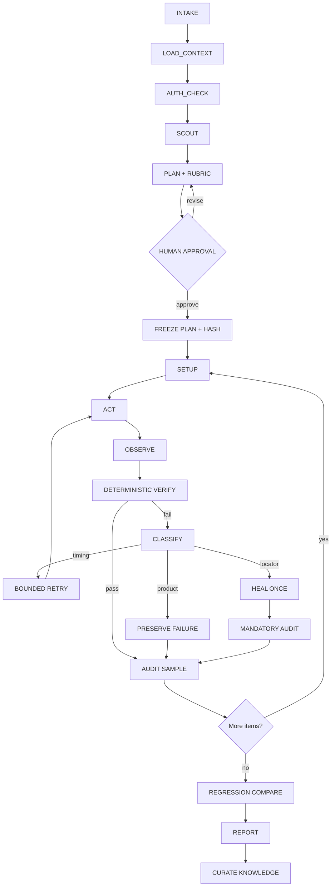

# Venti architecture

Venti is a generic QA harness for web products. It turns an intent and a target boundary into a
frozen test contract, executes that contract through the smallest truthful channel, and leaves a
replayable evidence trail plus durable target knowledge.

It is intentionally not tied to one product. A sanitized public target pack is just another target
key with a map, selectors, and findings; private environment-specific packs belong under the
gitignored `.local-targets/` directory.

## Design stance

The outer system is a deterministic workflow with bounded agentic pockets:

- **Workflow for repeatability:** intake, approval, plan freeze, item execution, verification,
  audit, report, and learning have explicit state transitions.
- **Agents for uncertainty:** scouting unfamiliar surfaces, composing a plan from observations,
  classifying a failure, proposing one locator recovery, and judging a declared rubric.
- **Files for memory:** the run directory is the event log and evidence store. Workers return paths,
  not copied transcripts. Target packs accumulate only audited facts.
- **Human gates for risk and ambiguity:** login, externally visible side effects, unclear semantic
  targets, and missing evidence pause the graph.

This matches the useful part of the industry pattern: Anthropic distinguishes predictable workflows
from flexible agents and recommends adding complexity only when needed; its multi-agent research
system uses an orchestrator-worker pattern, parallel independent work, explicit worker contracts,
and external memory. Playwright supplies the deterministic substrate: user-facing locators,
auto-waiting, retries, and traces. LangGraph's durable graph pattern is a useful model for
checkpointing and resuming human interrupts, but Venti does not require LangGraph at runtime.

References:

- [Anthropic — Building effective agents](https://www.anthropic.com/engineering/building-effective-agents)
- [Anthropic — Multi-agent research system](https://www.anthropic.com/engineering/multi-agent-research-system)
- [Playwright — Locators](https://playwright.dev/docs/locators)
- [Playwright — Retries](https://playwright.dev/docs/test-retries)
- [Playwright — Trace viewer](https://playwright.dev/docs/trace-viewer-intro)
- [LangGraph — Persistence](https://langchain-ai.github.io/langgraph/concepts/persistence/)
- [LangGraph — Human-in-the-loop interrupts](https://langchain-ai.github.io/langgraph/how-tos/human_in_the_loop/breakpoints/)
- [Stagehand — Browser agent primitives](https://github.com/browserbase/stagehand)
- [browser-use — Browser agent and benchmark](https://github.com/browser-use/browser-use)

## Graph contract



Every edge emits an event. Every item has a separate attempt directory. A restart reads the last
checkpoint and skips only items with a complete, evidence-backed result for the same plan hash.

## Channel adapters

The plan chooses one of three channels per target or item:

| Channel | Truthful for | Typical tools | Evidence |
|---|---|---|---|
| `browser` | end-user UI, rendering, accessibility, auth, interaction | `agent-browser`, Playwright | screenshot, URL, visible text, action ledger, trace |
| `api` | deterministic contracts, data, status, repeatable backend behavior | approved CLI/client | request metadata, redacted response, status, timing |
| `hybrid` | UI trigger plus backend truth or UI result plus API diagnosis | browser + approved client | both channels linked by item/attempt id |

An API must not be used to claim that the browser UI works. A browser must not be used when a
deterministic, authorized API contract would give a faster and more precise functional signal.

The executable provider registry lives in `src/providers/`:

| Provider | Implementation | Best use |
|---|---|---|
| `agent-browser` | `src/providers/agent-browser.js` | CLI sessions, auth restore, accessibility/tree tooling |
| `playwright` | `src/providers/playwright.js` | direct Playwright or an existing CDP browser |
| `browser-use` | `src/providers/browser-use-harness.js` + `.py` | Current Browser Use harness over CDP with semantic locators and real-input actions |
| `browser-use-cli` | `src/providers/browser-use-cli.js` | Legacy/persistent Browser Use CLI (`open/state/click/type`) |
| `jsonl` / `stagehand` / `browsergym` / `mcp` | `src/providers/jsonl.js` | external SDKs and MCP servers without coupling the core to their language/runtime |
| `http` | `src/providers/http.js` | safe, deterministic GET/HEAD API checks |
| `mock` | `src/providers/mock.js` | contract tests and CI without a browser |

Browser Use's current harness exposes a Python helper surface over a CDP endpoint; the built-in
`browser-use` provider launches that helper for each bounded operation and translates its
accessibility/DOM observations into the Venti contract. Browser Use Cloud raw browser sessions
also expose CDP; point the Playwright provider at them with `provider_config.cdp_url_env`, or use
`provider_config.cdp_ws_env` with the current Browser Use provider. Autonomous Agent tasks and
other fast-moving SDKs stay behind the JSONL boundary when their internal action/event model is
not stable enough for deterministic assertions.

## Reliability controls

### Locator ladder

1. role + accessible name;
2. label;
3. placeholder;
4. exact user-visible text;
5. test id explicitly supplied by the product;
6. short CSS selector;
7. XPath only as a last resort.

The last two are marked fragile. Snapshot-generated references are runtime-only. A locator heal is
an auditable event and can never silently upgrade a result to pass.

### Result state machine

```text
unstarted → running → verified
                    ├─ pass
                    ├─ fail
                    ├─ flaky      (attempts disagree)
                    ├─ blocked    (environment or budget)
                    ├─ needs_human
                    └─ pass_needs_review (healed or audit pending)
```

### Retry policy

Retries are diagnostic, not optimism. A retry is permitted only when a classifier says the failure
could be timing, a transient environment issue, or a stale interaction locator. Product assertion
failures are not healed. Retries are isolated attempts, and an externally visible side effect is
never repeated without an idempotency proof and a new approval gate.

### Evidence policy

The minimum evidence set is plan-configurable but defaults to screenshot, visible page text, URL,
and action ledger. On failure or first retry, retain a trace when the channel supports it. Evidence
coverage is reported as a first-class metric; a green-looking result with a missing screenshot is
not a pass.

## Target knowledge

```text
sites/<target-key>/
├── map.md        # routes, capabilities, states, completion/error signals
├── selectors.md  # only verified user-facing locator strategies
└── findings.md   # durable quirks, latency, risks, and recovery notes
```

The curator writes only audited observations. This prevents the common self-healing failure mode:
the harness clicks a semantically different element, records a green result, and poisons the next
run with a bad selector.

## Runtime compatibility

Venti's portable contract is plain Markdown, YAML, JSONL, and shell:

- Claude Code discovers `.claude/skills/mini-venti/SKILL.md` and `.claude/agents/`.
- Codex can use the same skill plus `AGENTS.md`, `agents/`, `plans/`, and `docs/contracts/`.
- A native subagent runtime may dispatch roles in parallel. Without one, the coordinator runs the
  same roles inline and records the degraded mode.
- The standalone Node runner requires Node 20+ plus YAML/JSON-Schema validation dependencies. Playwright,
  Browser Use, Stagehand, BrowserGym, and MCP remain optional provider runtimes.

## What makes this production-shaped

- immutable plan + content hash;
- explicit target and risk boundary;
- condition-based waits;
- append-only event/result/audit records;
- evidence on pass and fail;
- bounded retries and one-shot healing;
- mandatory audit of recovered/ambiguous results;
- baseline-pinned regression comparison;
- durable, audited memory;
- provider-agnostic role prompts and graceful inline fallback.

This is a strong foundation, not a claim that a repository has earned a particular star count. The
quality bar is earned by running real targets, calibrating rubrics against humans, and adding
regression fixtures for every failure mode discovered in production.
